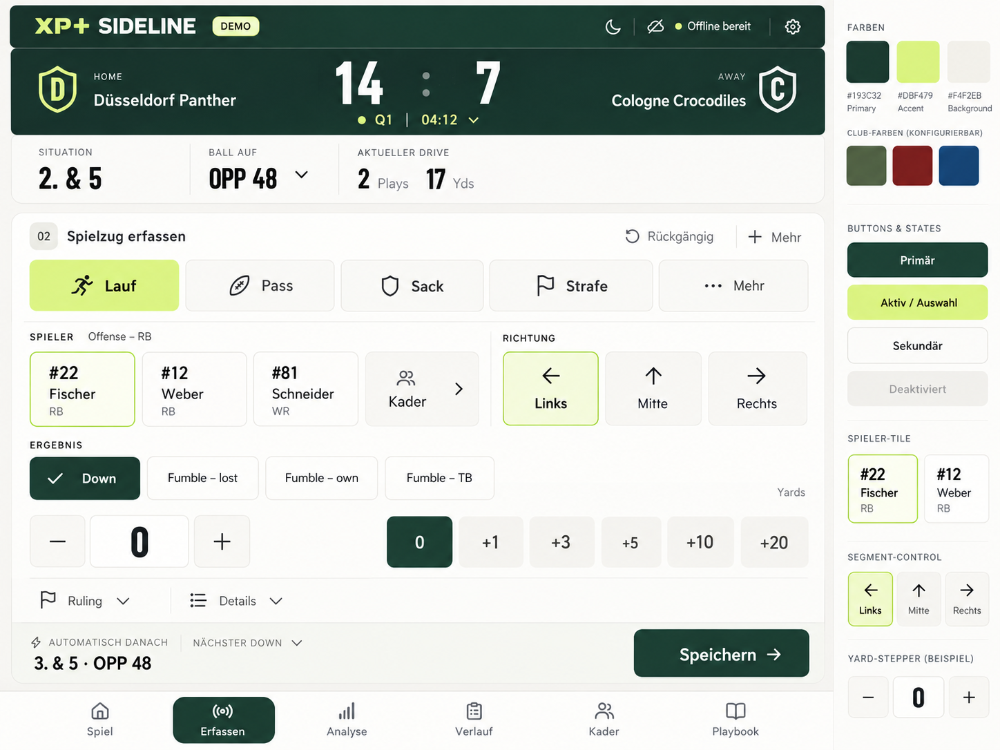

# Sideline – Gestaltung und Bedienung

Stand: 22. Oktober 2026. Ziel ist ein konzentriertes Tablet-Werkzeug für den nächsten Football-Spielzug und eine verständliche Kundenvorführung.

## Visuelle Richtung

Waldgrün, Lime und warmes Ivory bilden das Standardtheme. Die drei Clubfarben bleiben konfigurierbar: Primär für Identität und wichtige Aktionen, Sekundär für die aktuelle Auswahl, Akzent für ergänzende Clubflächen. Neutrale Flächen, lesbare Hilfstexte und Fehlerzustände haben eigene semantische Farben. Tag- und Nachtmodus ändern diese Oberflächen, ohne die Clubidentität zu ersetzen.

Flache Kacheln, wenige Trennlinien, kontrollierte Rundungen und tabellarische Ziffern schaffen Hierarchie. Die Matchanzeige bleibt sichtbar; Statistikdichte konzentriert sich auf „Analyse“. Die Erfassung zeigt zuerst Playtyp, Beteiligte, Ergebnis und Yards. Weitere Angaben öffnen erst bei Bedarf. Icons unterstützen lesbare Texte; Farbe allein bezeichnet keine Auswahl.

## Bedienvertrag

- Feste Navigation: Spiel, Erfassen, Analyse, Verlauf, Kader, Playbook. Kurze Buttons wie „Speichern“, „Mehr“, „Ruling“ und „Review“ vermeiden unnötige Breite.
- Drei direkte Spielerkacheln zeigen häufig passende Positionen. „Alle“ öffnet den vollständigen Kader; ein anderweitig gewählter Spieler bleibt sichtbar. Fehlende Zuordnungen können als „Offen“ erfasst werden.
- Große Touchflächen und eine erreichbare Speicheraktion unterstützen schnelle Wiederholungen. Fehler müssen sichtbar bleiben; fixierte Elemente dürfen weder Felder noch Fokus verdecken.
- Dialoge erhalten Namen und Fokus, lassen sich schließen und geben den Fokus zurück. Auswahlzustände, Pflichtgründe, Leerzustände und Speicherfehler sind ausdrücklich dargestellt.
- Demo und echte lokale Arbeit sind unterscheidbar. Import zeigt vor der Übernahme den Inhalt; ein vorheriger Stand bleibt als Sicherung zugänglich.

Die konkrete Umsetzung liegt in `app/assets/css/product.css`, `shared/theme.ts` und den Vue-Komponenten. Die Kontrastfunktion prüft normale Schrift gegen mindestens 4,5:1; das ist eine begrenzte technische Absicherung, keine vollständige Konformitätserklärung. Grundlagen: [Kontrast](https://www.w3.org/WAI/WCAG22/Understanding/contrast-minimum.html), [Zielgröße und Abstand](https://www.w3.org/WAI/WCAG22/Understanding/target-size-minimum.html), [modale Dialoge](https://www.w3.org/WAI/ARIA/apg/patterns/dialog-modal/).

## Imagegen-Konzept

**Datei:** `docs/design/sideline-ui-concept.png` · **Erzeugung:** eingebautes imagegen-Werkzeug mit einem vorhandenen App-Screenshot als Referenz.

**Zusammengefasstes Briefing, kein wortgetreues Promptprotokoll:** Eine stimmige, präsentationsfähige American-Football-App im Tablet-Querformat entwickeln. Bestehende Waldgrün-/Lime-/Ivory-Identität bewahren, flache Oberflächen und klare Typohierarchie einsetzen. Matchkontext kompakt halten; Playtypen, Spieler, Ergebnis und Yardauswahl priorisieren. Große direkt erreichbare Tasten, kurze Bezeichnungen und feste Navigation vorsehen. Die schnelle Erfassung soll sich wie ein Tablet-Werkzeug anfühlen.

Das Konzept beeinflusste Informationshierarchie, Spielerkacheln und die visuelle Vereinheitlichung. Es wird **nicht als Bitmap in der App ausgeliefert**. Text und Zustände des Bilds sind illustrative Gestaltung; die echte Anwendung besteht aus bedienbaren, überprüften Komponenten. Maßgeblich für den Produktstand sind die Screenshots und Verhaltenstests im [Prüfprotokoll](../VALIDATION.md), nicht das generierte Bild.

Der [Qualitätsbericht](../PRODUCT-QUALITY.md) nennt umgesetzte Maßnahmen und noch nicht verifizierte Plattformgrenzen.
